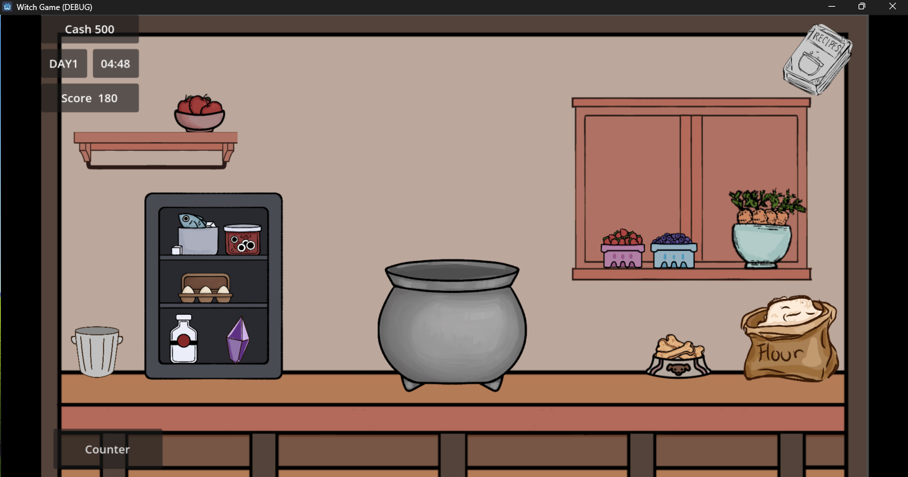
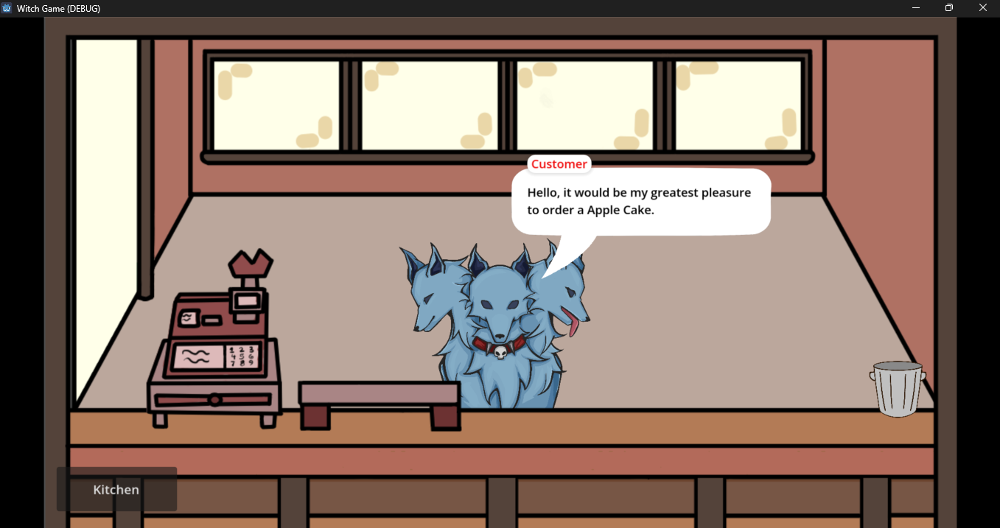
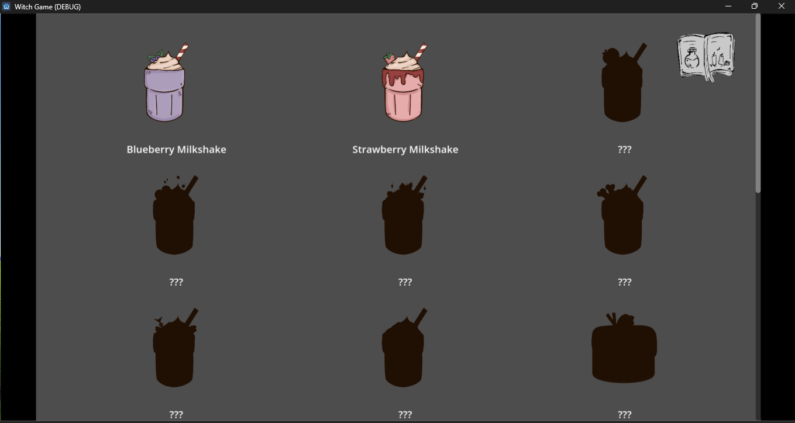

# BurnTheWitchV1
A cooking simulations where you play as a witch and serve supernatural creatures. You can take orders, cook, and serve it to the costumers to gain money in order to buy decorations and unlock more food options/costumers. (Still in development)

## Description
In the game you can move between the front counter and the kitchen. You can serve supernatural creatures that may ask for special orders or challenge you to complete almost impossible orders. Right now you can serve up to 10 costumers!

### Screenshots
(kitchen)  
  

(front counter)  
  

(Menu Recipes)  
  

## Getting Started
### Dependencies
Windows 10+
### Installing/Playing
- You can download the zip file game from Itchi.IO
- You can also try the game in the Itch.IO website  
Link: https://xorphic.itch.io/burnthewitch

## Help / Bugs
- If Playing in the Itch.IO web do not use any quit buttons.  
- Right now there is no way of saving so leaving means losing any progress.  
- Images that use Godot icon have no Asset assign to them yet.
## License  
This project is licensed under the MIT License. See LICENSE.md file for details  

## Other Info:
This game is made by [whatwendi](github.com/whatwendi), [Not-Da-Ramen-netsu](https://github.com/Netsu-Codes), and [Xorphic](https://github.com/3amstudiosgames)  
